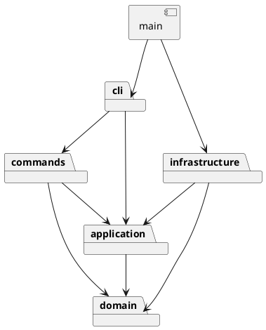

# SVG CLI Phase 1 项目说明

> 状态：S1（工程骨架、词法分析、`help`/REPL）与 S2（六类图形、文档树、Composite、工厂）已完成。

## 架构方案

### 1. 模块划分

| 目录 | 职责 | 当前状态 |
| --- | --- | --- |
| `src/domain/` | 图形抽象与具体叶子、`Group` 容器、几何约束、文档树、唯一 id 管理；`move`/`scale`/`set` 等通过多态统一处理叶子与容器 | **已实现（S2）** |
| `src/application/` | 编辑会话、命令接口、历史（undo/redo）、`DocumentStore` 端口；不读取 stdin、不直接操作文件 | 计划（S3/S5） |
| `src/commands/` | 每条编辑命令一个类：解析后的参数校验、调用领域行为、产生可撤销结果 | 计划（S3/S4） |
| `src/cli/` | 双引号词法分析、唯一的命令名分发、REPL、用户输出；stdin/stdout 只出现在这里 | **已实现（S1）** |
| `src/infrastructure/` | SVG XML 编解码与文件系统适配，实现 application 定义的端口 | 计划（S5） |
| `src/main.ts` | 组合根：创建具体实现并注入，负责启动 | **已实现（S1）** |
| `test/` | 单元测试、失败原子性、undo/redo、SVG 往返、真实 CLI 回放与依赖检查 | **部分实现（S1/S2）** |
| `examples/` | 可回放的命令脚本与示例 SVG 输入 | 计划（S6） |

当前落地内容：

- S1：`src/main.ts`、`src/cli/{Token,Tokenizer,CommandDispatcher,Repl}.ts`、`test/tokenizer.test.mjs` 与 TypeScript 工程配置。
- S2：`src/domain/` 下的 `Value`、`Shape`、`Rect`、`Circle`、`Ellipse`、`Line`、`TextShape`、`Group`、`SvgDocument`、`ShapeFactory`，以及 `test/domain.test.mjs`。



依赖只允许沿箭头方向；`main` 是唯一允许同时了解多个具体实现的组合根。

### 2. 设计模式的选择

| 模式 | 落地点 | 现状 | 说明 |
| --- | --- | --- | --- |
| **Command** | `src/commands/` 每个命令一个类；`src/application/` 的历史管理器执行/撤销/重做 | S1 仅有命令名分发骨架，S3 落地 | 每条编辑命令封装为对象，成功后进入历史；`group g1 r1 c1` 等复合操作是一个撤销单元。历史只接受成功执行的命令，失败不改变文档 |
| **Composite** | `src/domain/` 的 `Shape` 抽象、叶子图形与 `Group` 容器 | **已实现（S2）** | 叶子与容器共用 `move`/`scale`/`set` 等接口；`delete` 由 `SvgDocument` 按 id 删除，容器连同子孙。`create ... in <g>`、`group`、`ungroup`、`addto` 均基于该结构 |
| **Factory** | `src/domain/ShapeFactory.ts`：类型名 → 具体类 | **已实现（S2）** | 集中注册六种内置类型；S3/S5 接入后，CLI 创建与 SVG 读入共用同一工厂，避免在领域代码中散布 `switch(tag)`；按名分派集中于此，并标记为后续插件化重构点 |
| **Adapter / 依赖倒置** | `application` 定义 `DocumentStore` 端口；`infrastructure` 实现文件与 XML 编解码 | S5 落地 | 应用层只依赖端口，便于替换存储介质或在测试中使用内存实现 |

**Command 的目标契约**（S3 实施）：

```ts
interface Command {
  execute(doc: Document): CommandResult;
  undo(doc: Document): void;
}
```

编辑命令先在隔离的工作副本上执行，成功后由历史管理器提交；这样即使分组/递归修改中途失败，也不会污染当前文档。`CommandDispatcher` 只负责“命令名 → 命令对象”的一次性映射，不承载领域逻辑。

### 3. 依赖方向规则

| 模块 | 允许依赖 | 理由 |
| --- | --- | --- |
| `domain` | 仅 TypeScript/领域自身（不得依赖 Node IO、其他业务模块） | 领域模型是核心，保持可独立测试与复用；隔离文件、终端等外部细节 |
| `application` | `domain` | 应用层编排领域对象；不关心具体 UI 与文件格式 |
| `commands` | `application`、`domain` | 命令是薄适配层：校验参数后调用应用/领域行为 |
| `cli` | `commands`、`application` | CLI 只做输入解析、分发与输出；可被 GUI/agent 替换 |
| `infrastructure` | `application`、`domain` | 实现应用层端口并读写领域对象；不反向被领域依赖 |
| `main` | 所有模块 | 唯一组合根，负责创建具体实现并注入 |
| `test` | 所有模块 | 测试需要从外部验证各层行为 |

附加规则：

- 禁止反向依赖与循环依赖；一旦出现即列为待处理项。
- 文件系统与 stdin/stdout 只能出现在 `infrastructure` 和 `cli/Repl`，不得进入 `domain`/`application`。
- 按名字分派只允许两处：`cli/CommandDispatcher`（命令名 → 命令）与 `domain/ShapeFactory`（类型名 → 类），两处均标记为后续插件化重构点。
- 当前检查结果：`domain` 仅依赖自身（`Shape`/`Value`/`Group`）与 TypeScript 类型，不依赖 Node IO；`cli` 仍独立，尚未依赖 `domain`；`main → cli`。无反向或循环依赖。按名分派已出现于 `cli/CommandDispatcher` 与 `domain/ShapeFactory`，均为约定内、待插件化重构点；当前无违反项。

### 4. 变化点假设

| 可能的变化 | 预留措施 | 决定不做/不提前做的理由 |
| --- | --- | --- |
| 新增图形类型与 `box` 插件 | `Shape` 抽象与 `ShapeFactory` 已落地并集中注册六种内置类型；序列化计划保留 `data-kind` 以便读回还原 | 本阶段明确不实现 `box`（阶段边界），避免过早引入插件装载机制 |
| 增加 GUI 或 agent 输入通道 | 应用/命令不读取 stdin，输入全部适配在 `cli`；命令对象不依赖终端 | 本阶段只交付 CLI，不提前抽象多前端 |
| 更换存储介质（内存、数据库、远程） | `DocumentStore` 端口 + `infrastructure` 适配器 | 本阶段只需文件读写，端口先定义、实现随 S5 落地 |
| 大文档下撤销性能 | 当前计划采用快照式撤销，保证正确性；后续可替换为差量命令 | 本阶段文档规模小，优先正确性；不做持久化树/增量结构 |
| 支持更多 SVG 语法 | 编解码集中在 `infrastructure`，领域不感知 XML | 明确支持边界；遇到不能安全处理的结构必须报错，不静默丢弃 |

## 过程记录

### S0：核对需求与确定开发顺序

- 核对阶段边界：`box` 不实现；不能按 tag 到处分派；必须一类一文件；根级 `g` 禁止解散。
- 确定模块划分、依赖方向与分步实施顺序，建立 Git 仓库和初始文档。

### S1：CLI 骨架与输入边界

- 建立严格 TypeScript 工程（ESM、NodeNext、`strict`、`noUncheckedIndexedAccess`、`noUnused*`），提供 `build` / `cli` / `test` / `check` 脚本。
- 逐行 REPL：启动横幅、`svg>` 提示符、逐行分发；`main` 仅负责组装。
- 独立 `Token` / `Tokenizer`：整行 `#` 注释忽略；空白分词；双引号保留空格与 Unicode；支持 `\"`、`\\` 转义；未闭合引号、引号出现在参数中间、引号后缺空白均报错。
- `CommandDispatcher`：唯一命令名分发点，目前只实现 `help`；未知命令与其他异常统一转成一行 `error: ...`，且不中断后续命令。
- 验证：`npm install`、`npm run build` 通过；`npm test` 3/3 通过；管道回放 `help`、非法命令与注释行，输出符合约定。
- 阶段边界：本步不含图形模型、编辑命令、undo/redo、SVG 读写。

### S2：领域模型、Composite 与工厂

- `Value` 统一数值与 id 校验：拒绝 `NaN`、`Infinity`、`1px` 等非有限数；尺寸/半径非负；缩放因子为正；id 非空且不含空白。
- `Shape` 抽象保存几何属性与样式，提供 `move`/`scale`/`set`/`attributes`/`summary`；叶子 `Rect`、`Circle`、`Ellipse`、`Line`、`TextShape` 各自实现移动与显示，`scale` 统一作用于全部几何属性。
- `Group` 实现 Composite：递归 `move`/`scale`，`insert` 拒绝把容器收入自身子孙；`clone` 深拷贝整棵子树；样式保存在组自身，读回时按 SVG 规则由子元素继承，不改写子元素属性。
- `SvgDocument` 管理根节点与画布尺寸，提供 `find`/`require`/`requireContainer`/`parentOf`/`add`/`delete`/`clone`；`add` 在修改前检查全局 id 唯一性（大小写敏感），失败不改变文档。
- `ShapeFactory` 集中注册 rect/circle/ellipse/line/text/g 六种类型及其参数 schema；未知类型报 `unknown shape type`，参数个数不符报错；`box` 按阶段边界拒绝。
- 验证：新增 4 个领域测试；`npm test` 7/7 通过。
- 阶段边界：域模型尚未接入 CLI；编辑命令、历史、group/ungroup、SVG 读写均未实现。

### 来自实现与自查的修正

- **引号信息必须保留**：`create text t 1 2 "开始 in here"` 中的 `in` 是文本内容，不能当作 `in <containerId>` 子句。因此 `Token` 记录 `isQuoted`，后续语法解析只在未加引号的 token 上识别关键字。
- **注释只认整行**：`#eee` 是常用颜色值，不能按 `#` 截断；实现只把 `trimStart()` 后以 `#` 开头的行视为注释。
- **错误不能终止 REPL**：分发器捕获所有异常并输出单行 `error:`，保证后续命令仍可执行，符合“命令失败不改变状态”的约定。
- **测试必须先构建**：测试导入 `dist/` 下的 ESM 产物，`npm test` 显式串联 `npm run build`，避免测试读到旧产物。
- **先校验再修改**：`SvgDocument.add` 在插入前完整检查 id 冲突，避免插入到一半失败留下半更新状态；测试覆盖“失败插入后文档不变”。
- **深拷贝而非共享引用**：`clone` 递归复制每个子图形，测试确认修改副本不会影响原文档。
- **容器样式不写回子元素**：`Group.set('fill', …)` 只记录在容器上，子元素属性保持原样，由 SVG 继承规则生效；测试验证子元素未被改写。
- **缩放包含位置与尺寸**：`Shape.scale` 对几何表中的所有属性乘同一因子，符合“位置与尺寸一起缩放”的命令语义。

## 一致性自查

1. **模块划分**：与终态方案**暂不一致**——实际已有 `src/cli/`、`src/domain/`、`src/main.ts`、`test/tokenizer.test.mjs`、`test/domain.test.mjs` 与工程配置；`application`、`commands`、`infrastructure`、`examples` 尚未创建。该差异属于分步实施中的计划内未完成项，已记入“模块划分·当前状态”、S1/S2 过程记录与修正记录；待 S3–S6 完成后重新逐项核对。
2. **依赖方向**：现有依赖为 `main → cli`；`cli` 内部为 `Tokenizer → Token`、`CommandDispatcher → Tokenizer`、`Repl → CommandDispatcher`；`domain` 内部为具体图形 → `Shape` → `Value`，`Group` 依赖 `Shape`/`Value`，`SvgDocument` 依赖 `Shape`/`Group`/`Value`，`ShapeFactory` 依赖各具体图形。无反向依赖或循环；`cli` 尚未依赖 `domain`（S3 接入），stdin/stdout 仅出现在 `Repl`，文件 IO 尚未出现。

## 质量保证手段

- **已执行**：`npm install`、`npm run build`、`npm test`（7/7 通过：分词 3 项 + 领域 4 项），并用管道向 CLI 回放 `help`、`oops`、`# comment`，确认错误隔离与注释行为。
- **自动门禁**：TypeScript 严格编译（`strict`、`noUncheckedIndexedAccess`、`noUnusedLocals/Parameters`）+ `node --test`。
- **当前测试覆盖**：
  - 分词：引号、转义、Unicode、Windows 路径、空字符串；整行注释；未闭合引号与非法引号位置；错误恢复；`help` 分发。
  - 领域：五类叶子多态 `move`/`scale`；嵌套 `Group` 递归、深拷贝、样式继承；全局大小写敏感 id 唯一性与失败插入不改变文档；未知类型、非法数值、负尺寸、属性白名单、自嵌套循环与非法缩放因子。
- **后续计划**：S3–S5 增加编辑命令、失败原子性、undo/redo 隔离、group/ungroup/addto/front/back 与顺序检查、缺失 id 自动补全、XML 转义与 SVG round-trip 测试；S6 增加模块依赖与一类一文件检查、回放 `phase_cli_1.md` 的典型会话。
