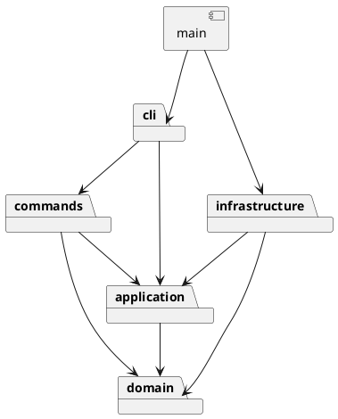

# SVG CLI Phase 1 项目说明

## 架构方案

### 模块划分

| 目录 | 职责 |
| --- | --- |
| `src/domain/` | 封装图形、几何约束、树结构及文档；叶子和容器多态操作 |
| `src/application/` | 编辑会话、命令接口、历史管理、存储端口 |
| `src/commands/` | 每条命令一个类，验证参数并调用领域行为 |
| `src/cli/` | 双引号词法分析、唯一的命令名分发、REPL、用户输出 |
| `src/infrastructure/` | SVG XML 编解码、文件系统适配 |
| `src/main.ts` | 组装依赖并启动应用 |
| `test/` | 模型、命令、文件往返、真实 CLI 验收与架构检查 |
| `examples/` | 可回放会话和 SVG 输入 |

### 设计模式的选择

- **Command**：编辑命令对象执行、撤销、重做；历史管理器只接受成功执行的命令。一条命令是一个撤销单元。
- **Composite**：抽象 Shape、具体叶子、Group 共用 move/scale/set 等接口。容器递归移动和缩放子孙，容器样式遵循 SVG 继承。
- **Factory**：集中创建六种内置图形，读入与 CLI 共用。领域行为、显示和序列化通过多态完成，不散布类型分支。
- **Adapter / 依赖倒置**：应用依赖文档存储接口；文件与 XML 实现在 infrastructure。

### 依赖方向规则

domain 不依赖其他业务模块或 Node IO；application 只能依赖 domain；commands 只能依赖 application/domain；cli 只能依赖 commands/application；infrastructure 只能依赖 application/domain；main 负责组装。test 可依赖全部模块。循环依赖以及反向依赖均列为待修复项。

按名字分派只保留两处：`cli/CommandDispatcher`（命令名→类）和 `domain/ShapeFactory`（类型名→类）。**两处均为待重构点**：下一阶段替换成可注入的插件注册机制；本阶段不增加动态插件装载。

### 变化点假设

1. 新图形与 box 插件：保留抽象 Shape 与集中工厂，但不提前实现 box。
2. GUI/agent 输入：应用与命令不读取 stdin，可替换 CLI。
3. 存储介质：通过 DocumentStore 端口替换文件适配器。
4. 大文档撤销性能：快照策略未来可换差量命令；本阶段不做持久化树。
5. 更多 SVG 语法：编解码集中隔离；明确支持边界，遇到不能安全处理的结构应报错，不静默丢弃。

## 过程记录

### S0：先核对需求与确定开发顺序

- 核对了阶段边界：box 不实现；不能按 tag 到处分派；必须一类一文件；根级 g 禁止解散。
- 构建相关架构方案和依赖，定义初始开发目标。

## 一致性自查

待各步骤实现后据实填写。

## 质量保证手段

每步运行 TypeScript 严格检查及相关测试；最终覆盖全部命令、失败原子性、undo/redo 隔离、缺失 id 补全和 SVG round-trip。